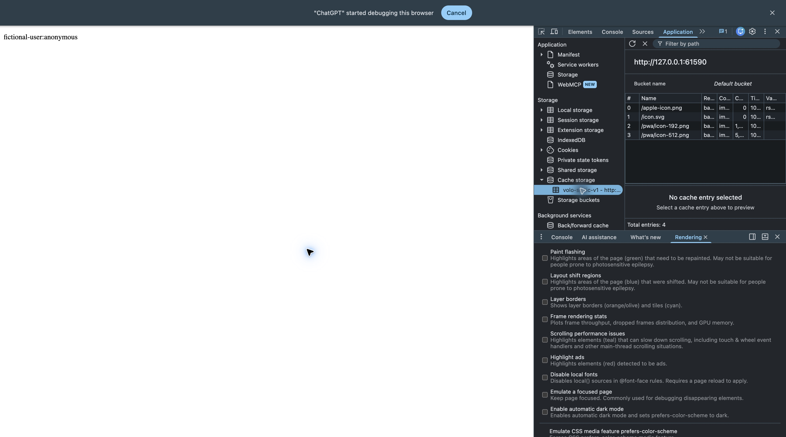

# VOLO-225 — Static-only service worker

VOLO-224 is merged. Production root layout registers `/sw.js` at `/` with `updateViaCache: none`. Unsupported browsers and registration failures continue normal browsing. No push, sync, queued writes, offline HTML or private response fallback is added.

## Cache contract

Only exact same-origin queryless GETs for `/pwa/icon-192.png`, `/pwa/icon-512.png`, `/icon.svg`, `/apple-icon.png` can use `volo-static-v1`. Navigations, RSC/prefetch/authorization/range requests, other paths, manifest/worker requests and all mutations stay on the network. Icon network requests omit credentials and incoming headers; only successful, nonredirected basic image responses of the expected type without private/no-store/cookie/auth-vary policy enter the cache. Offline page loads and writes fail normally, never return cached private content or synthetic write success.

Install prefills only these icons; activation removes obsolete `volo-static-` caches and claims clients. Immediate activation is safe here because there is no cached app shell or private/API protocol. **Bump `CACHE_NAME` when icon bytes change.** New application pages/API code always come from the network.

Exact same-origin queryless `/auth/logout` POST (including trailing slash) schedules deletion of owned caches via `waitUntil` without intercepting the auth request/response. Serialized writes and a generation guard stop earlier fetches in that worker from refilling the cache after the purge. Later requests can cache public icons again. The existing server logout still owns Origin checking, cookie/setup removal and redirects; no server auth behavior changes. This cleanup is not a durable ban on public icon caching.

Worker response uses JavaScript MIME, nosniff, no-store browser/CDN/Netlify cache policy and same-origin worker CSP. Proxy excludes exactly `/sw.js`; lookalike/child paths stay matched.

## Evidence — 2026-10-26

- Five focused actual-worker-script tests passed: explicit install allowlist/credential omission, private/RSC/auth/token/query/cross-origin/write exclusions, offline icon hits/network misses, unsafe response refusal, activation cleanup and logout/in-flight refill prevention. Tests use a small VM event/CacheStorage fixture; they do not emulate a whole browser.
- All eight existing Proxy unit tests passed, including `/sw.js` and private lookalikes.
- Existing compiled Proxy HTTP fixture passed with actual Next config, worker bytes/security/cache headers, real manifest/mobile metadata/icon dimensions, and public assets under anonymous/malformed/outage cookies with no Auth calls or cookie changes. Existing refresh/cookie isolation, HTML/RSC/prefetch, private response, redirects and outage checks also passed. No parallel harness was added.
- Type generation, TypeScript, focused ESLint and diff checks passed.
- Independent final review approved with no findings.
- Owned local production fixture in Chrome: DevTools showed `/sw.js` activated and running, controlling the local page. Cache Storage showed exactly four entries, all allowed public icons. Chrome also exposed its Install VOLO action; this was not used or counted as an installation pass.

The browser check reused the existing Proxy fixture. Its server-rendered page is a minimal HTTP test page, while registration, worker, headers and metadata are production sources. Browser test storage/registration was cleared only on the owned localhost origin, its tab was closed, and temporary server/Auth fixtures were cleaned up. Existing server logout evidence remains in the authentication/private-cache verification notes; the new worker cleanup/race checks are focused script tests, not a claim of a completed mobile logout journey.

## Remaining verification

Mobile Safari/Chrome installation, standalone launch, installed-app byte updates and full authenticated logout/offline journey remain the VOLO-92 target-device pass. Desktop worker activation/cache inspection and modeled version cleanup do not prove those device behaviors. No full-suite or SQL matrix run: this change has no schema/business mutation. Netlify Deploy Preview and production release verification are separate; no hosted data/accounts/settings or production publication was performed.

References: installed Next 16.3.8 PWA guide and metadata conventions; [Service Worker fetch event](https://developer.mozilla.org/en-US/docs/Web/API/ServiceWorkerGlobalScope/fetch_event). Existing private-response contract: [private caching](private-caching.md).
