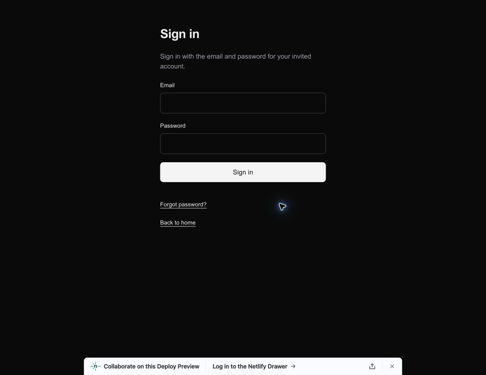
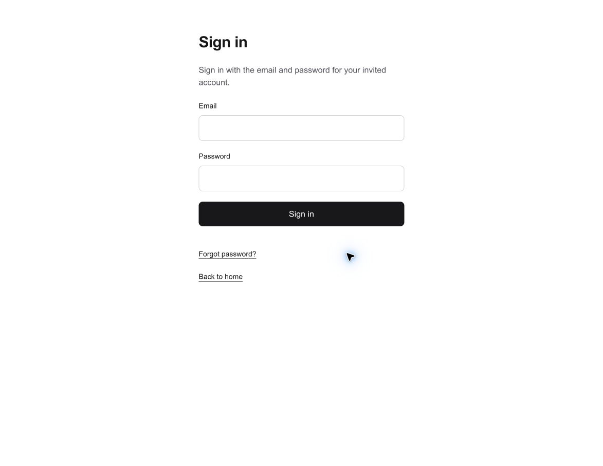

# VOLO-238 — Light UI verification

Verified 2026-10-26. All 50 component edits mechanically remove only `dark:` utilities; existing light classes and workflow code are unchanged. Global CSS fixes white/#171717 and `color-scheme: only light`. The supported Next viewport export emits light color scheme and #ffffff theme color. Both standalone confirmation HTML responses include matching metadata with their existing restrictive CSP unchanged. No manifest exists yet; PWA work remains a separate ticket.

## Checks

- Type generation and TypeScript: passed.
- Focused ESLint on modified source/helper files: passed.
- Existing confirmation unit tests: 15 passed.
- Production build of the existing isolated browser/auth fixture: passed. Browser mode now uses the actual root layout/metadata, removing only remote Google font loading so the fixture remains offline.
- Source audit: no remaining `dark:` or system dark-palette rules in app source; exact comparison confirms no other component changes.
- Independent review: approved, no findings.

## Browser evidence

Chrome DevTools on an owned tab emulated dark preference (`matchMedia` confirmed true). Before: body background rgb(10,10,10), text rgb(237,237,237). After: background rgb(255,255,255), text rgb(23,23,23), root scheme `light only`, actual generated metas `color-scheme=light` / `theme-color=#ffffff`.

| Before, dark preference | After, dark preference |
| --- | --- |
|  |  |

Using disposable local accounts/data, checked dashboard, directory, profile editor, flight feed/filters, flight creation, notifications, messages, invitation/member/report administration and MVP metrics under dark preference. Checked flight details, acceptance feedback/disabled saving controls, accepted connection, conversation opening/empty history/composer, and light preference in a fresh tab. Native date/text/select/file controls inherit the light palette; feed dates explicitly use light scheme. Login/recovery validation feedback stays readable, keyboard focus retains its 2px outline, and the standalone invalid-confirmation response renders white with its CSP intact.

At 390×844, dark-preference flight feed/creation, directory, profile editor, messages, notifications and invitations had no horizontal overflow. Light-preference dashboard, profile editor, invitations and messages also stayed white without overflow. Reset-link-required and signed-out/invalid-input authentication states remained light. Account setup without a valid invitation correctly redirects to sign-in; no real invitation/password or hosted member data was changed.

The browser fixture reuses production routes, styles and owned local auth/data; Google fonts are omitted. This is representative visual coverage, not exhaustive coverage of every state. Full regression/SQL matrices and production release checks were not run for this styling-only change. No migration or release is included. Netlify Deploy Preview and production verification remain separate; production publishing stays locked. Temporary local data/resources and owned emulation tabs were cleaned up; viewport override was reset.
